# ⚡ EnergyGuard — Monitoramento Inteligente de Energia Elétrica

O **EnergyGuard** é um sistema experimental de monitoramento de grandezas elétricas, desenvolvido para acompanhar medições de energia, visualizar o histórico de funcionamento e auxiliar na identificação de comportamentos incomuns em instalações monitoradas.

O projeto utiliza um **ESP32** para coletar e transmitir leituras, que são recebidas por uma **API/back-end** e apresentadas em um painel web. A interface reúne dados de tensão, corrente, potência, energia acumulada, frequência, fator de potência, conectividade do dispositivo, alertas e análises de anomalias.

> **Importante:** o protótipo e suas classificações têm finalidade experimental e de apoio à análise. Não são instrumentos certificados de medição, proteção elétrica ou diagnóstico definitivo de falhas.

## 🔗 Acesso ao sistema

O EnergyGuard possui uma interface web de monitoramento. **O endereço público do painel não foi informado** neste material; inclua-o aqui quando estiver disponível.

## 🖥️ Interface do sistema

A interface permite consultar a leitura mais recente, acompanhar gráficos, analisar o consumo, investigar ocorrências, configurar regras de alerta e verificar o estado do ESP32.

### Painel principal

A **Visão geral** reúne potência, corrente, tensão, potência aparente e reativa, fator de potência, frequência, energia total, estado do dispositivo e resumo das leituras. O painel também exibe avisos contextuais quando uma grandeza não está sendo detectada.

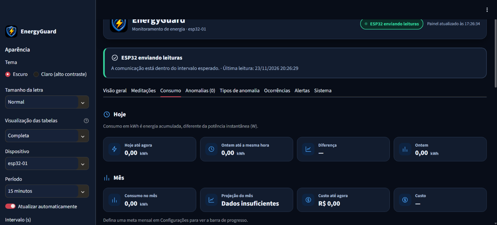

### Últimas leituras

As tabelas mostram os valores recebidos do ESP32, incluindo tensão (V), corrente (A), potência (W), energia (kWh), frequência (Hz), fator de potência, intensidade do Wi-Fi (RSSI), tempo de atividade, falhas de envio, identificador e horário da amostra. Há opção de exportação CSV em partes do painel.

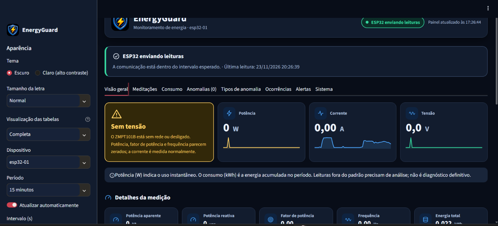

### Gráficos das medições

A aba **Medições** apresenta a evolução temporal de tensão, corrente, potência e outras grandezas, com opção de selecionar variáveis e indicar amostras marcadas como anomalia.

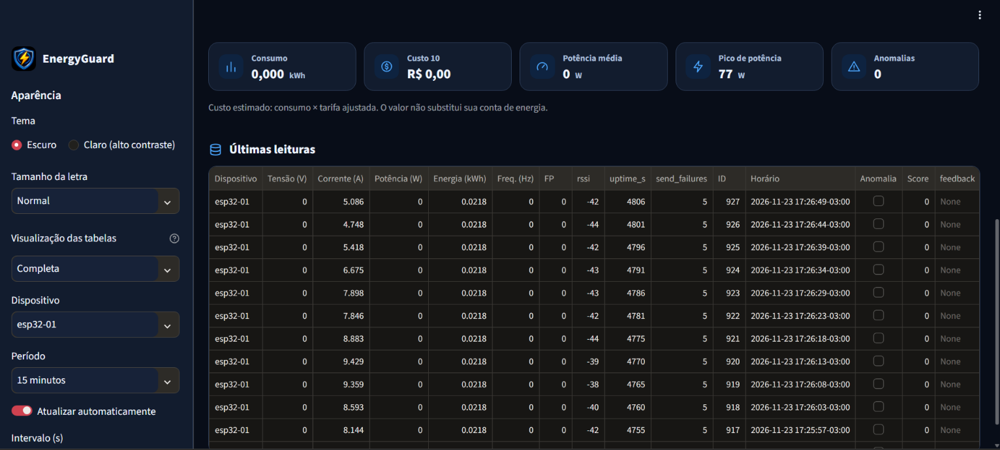

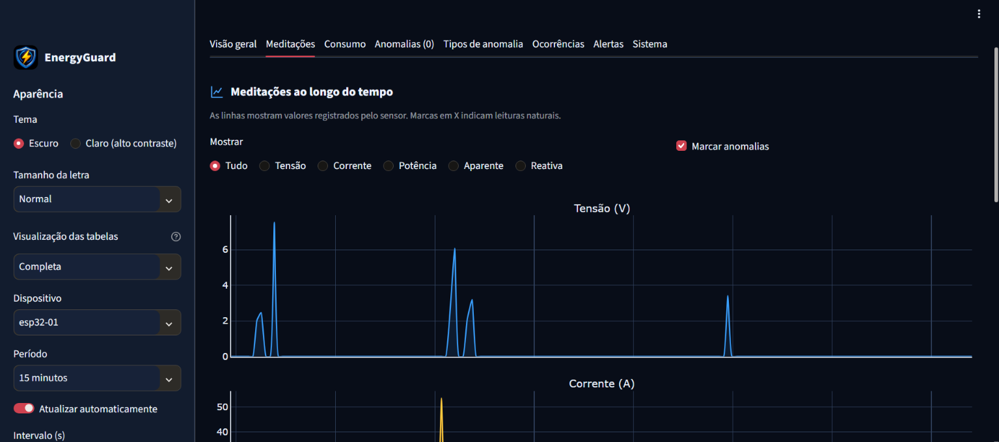

### Histórico de medições

A tabela de previsão/exibição do período permite inspecionar os registros individuais do intervalo escolhido e baixar as leituras em CSV.

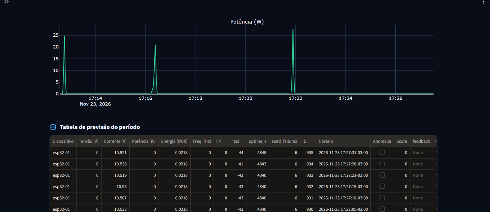

### Consumo de energia

A aba **Consumo** apresenta comparativos de hoje e ontem, consumo mensal, projeção do mês, custo estimado e gráficos de consumo por hora e por dia. Os cálculos dependem das leituras acumuladas e de configurações como a tarifa de energia.

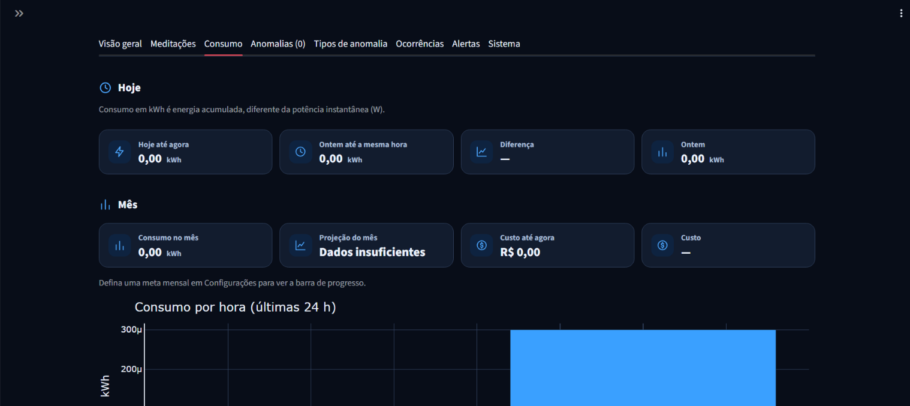

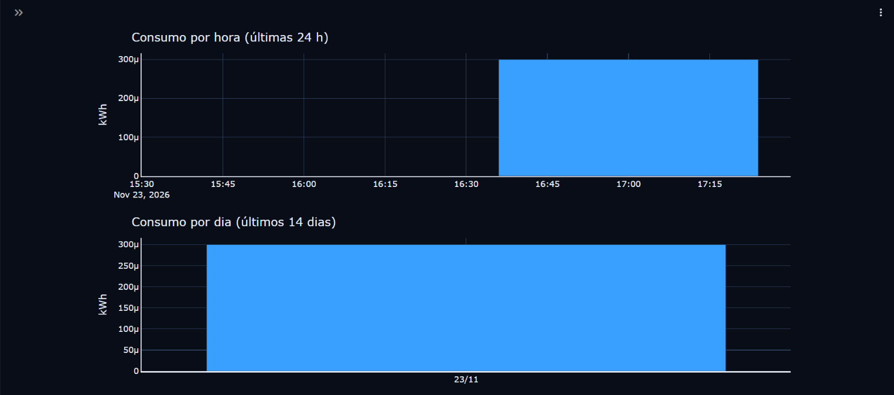

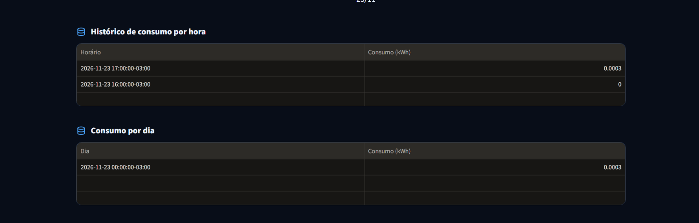

### Detecção de anomalias

A aba **Anomalias** apresenta o score calculado pelo modelo de detecção. No gráfico mostrado, valores abaixo de zero são considerados anômalos pelo critério exibido. O usuário também pode rotular leituras para apoiar a avaliação do modelo.

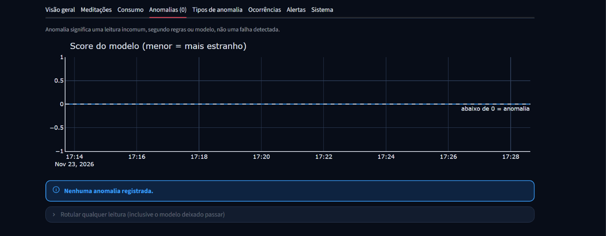

### Tipos de anomalia e ocorrências elétricas

O EnergyGuard também apresenta classificações e indícios de situações como possíveis interrupções de tensão e medições inconsistentes, além de reunir a linha do tempo dos episódios observados. Essas ocorrências são **indícios baseados em amostras**, não confirmações de falhas na rede.

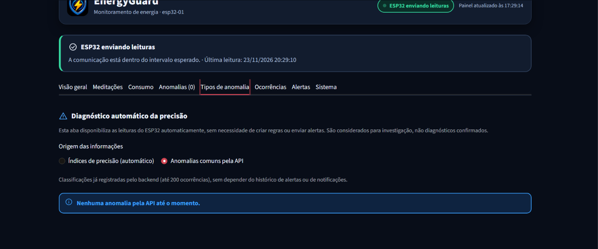

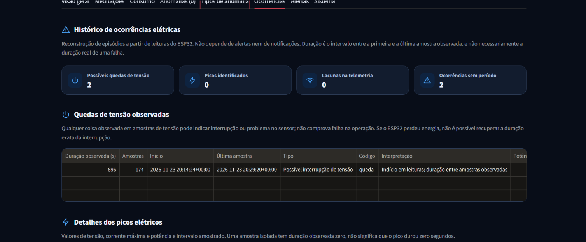

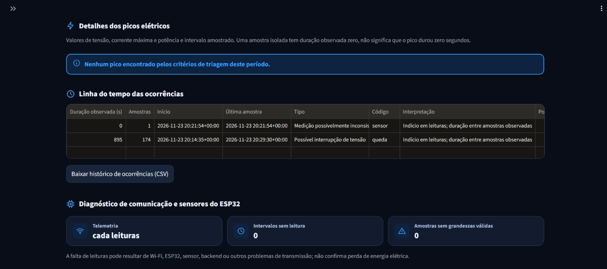

### Diagnóstico e relatório de qualidade

A interface reúne verificações de comunicação e sensores, estatísticas de tensão e frequência, quantidade de amostras e resumo de ocorrências. Também permite exportar um relatório de qualidade em CSV.

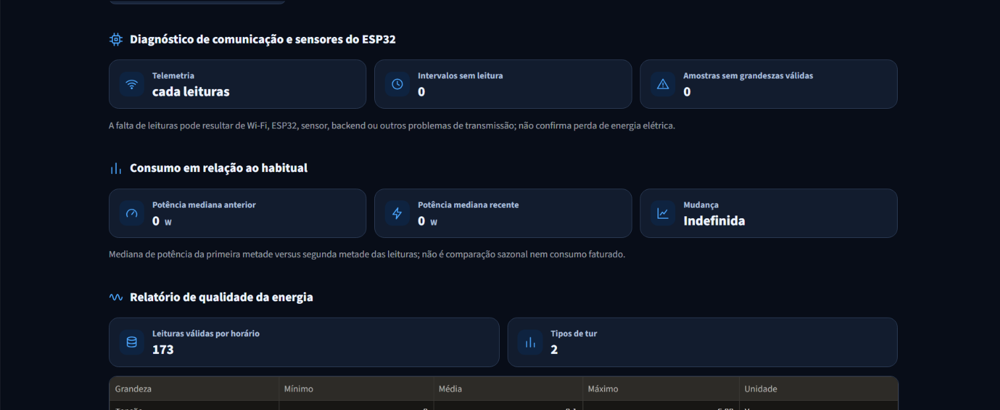

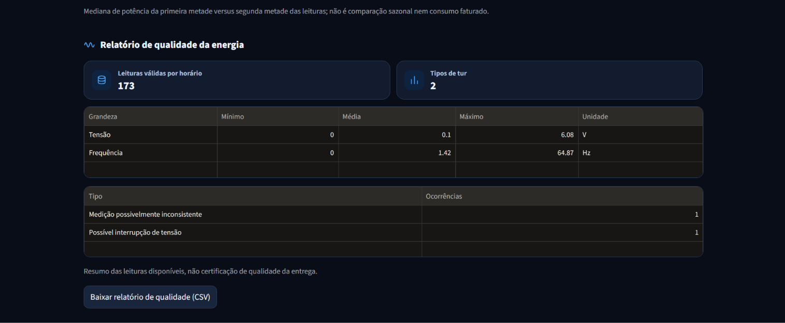

### Alertas

O sistema oferece configuração de regras por limite e histórico de alertas. Nas imagens, os avisos por **Telegram e e-mail ainda não estão configurados**, portanto essas notificações dependem de credenciais e configuração no back-end.

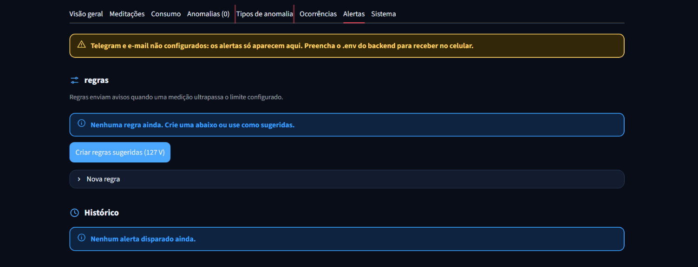

### Sistema: saúde, validação e modelo

A aba **Sistema** disponibiliza indicadores de sinal Wi-Fi, tempo ligado, falhas de envio, cobertura e intervalo entre leituras. Uma seção de validação compara leituras recentes com medições de um instrumento externo. A seção do modelo informa estado de treinamento, quantidade de amostras e parâmetro de contaminação.

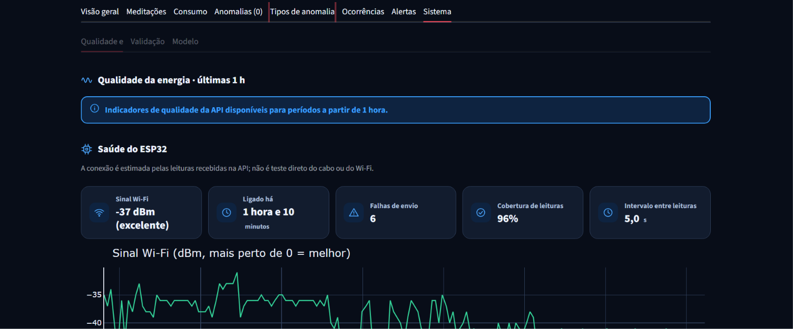

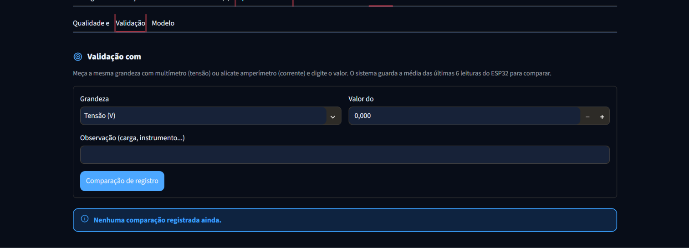

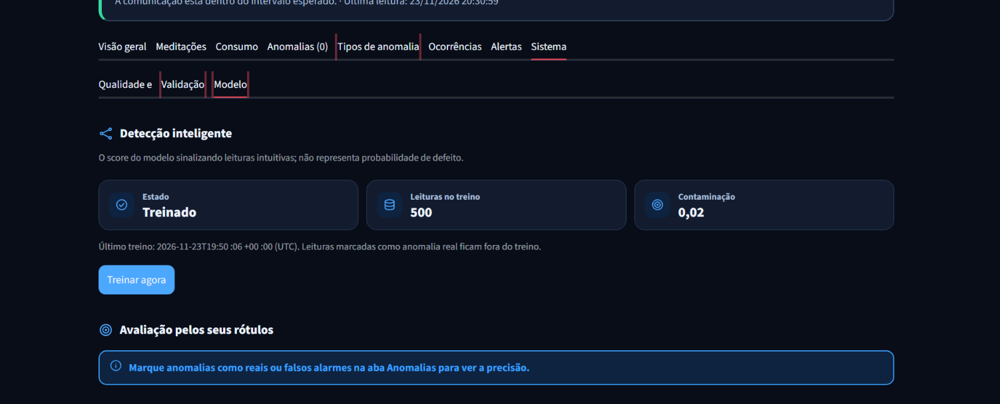

## 🔌 Protótipo físico

A montagem experimental apresentada na fotografia inclui um **ESP32**, uma **protoboard**, fios de conexão, um **módulo de relé**, um **sensor de corrente SCT-013** e componentes de condicionamento/medição. A interface identifica o **ZMPT101B** como módulo de tensão utilizado. O modelo exato do sensor de corrente deve ser confirmado no hardware ou no código.

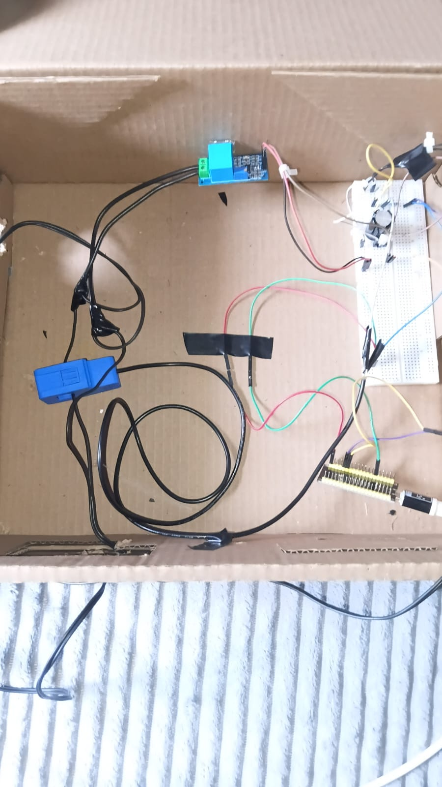

> ⚠️ **Segurança elétrica:** a montagem fotografada utiliza papelão, protoboard e conexões provisórias. Não é apropriada para uso permanente ou operação com partes energizadas da rede elétrica expostas. Para qualquer teste em tensão de rede, utilize isolamento, proteção mecânica, componentes com especificações apropriadas e supervisão de profissional habilitado. O ESP32 e a protoboard devem permanecer isolados da rede.

## ⚙️ Funcionalidades

- Aquisição e transmissão de leituras pelo ESP32 via Wi-Fi;
- Monitoramento de tensão, corrente, potência e energia acumulada;
- Exibição de frequência, fator de potência e grandezas complementares;
- Visualização de medições em tempo real e séries históricas;
- Consulta do consumo por hora, por dia e por mês;
- Estimativa de custos com base na tarifa configurada;
- Gráficos interativos e seleção de períodos;
- Identificação de leituras incomuns com modelo treinado;
- Rotulagem de resultados para avaliação da detecção;
- Reconstrução de possíveis quedas de tensão e inconsistências;
- Monitoramento de sinal Wi-Fi, falhas de transmissão e disponibilidade das leituras;
- Configuração de regras e consulta do histórico de alertas;
- Validação comparativa com instrumentos externos;
- Exportação de leituras, ocorrências e relatórios em CSV;
- Opções de tema, tamanho de fonte e apresentação das tabelas.

## 🏠 Possíveis aplicações

O EnergyGuard pode apoiar experimentos e estudos em **residências, laboratórios didáticos, salas de aula, bancadas de testes, e vista de consumo de dispositivos eletronicos caso esteja conectado a uma tomada ou no circuito eletrico e projetos de automação**, desde que respeitadas as condições de segurança e as limitações de calibração e precisão.

O sistema foi concebido para auxiliar a observação de variações elétricas e tendências de consumo, não para substituir medidores homologados ou sistemas de proteção.

## 🏗️ Arquitetura do sistema

O fluxo funcional observado no painel é:

```text
Sensores elétricos → ESP32 → Wi-Fi → API / Back-end → Armazenamento de leituras → Painel web
                                          └→ Análise de anomalias e ocorrências
```

1. Os módulos de medição fornecem sinais relacionados às grandezas elétricas.
2. O ESP32 coleta as leituras e transmite os registros pela rede Wi-Fi.
3. A API recebe os dados e os disponibiliza ao back-end.
4. O sistema mantém um histórico usado para gráficos, consumo, relatórios e análises.
5. O painel web consulta as informações e mostra indicadores, alertas e resultados do modelo.

**Observação:** o provedor do banco de dados, a linguagem do back-end e a biblioteca dos gráficos não são identificáveis com segurança apenas pelas capturas e precisam ser confirmados no repositório de código.

## 📁 Estrutura sugerida do repositório

A organização abaixo é **uma sugestão**, não uma afirmação sobre as pastas atuais do código:

```text
EnergyGuard/
├── backend/                 # API, processamento e persistência
├── esp32/                   # Firmware do microcontrolador
├── frontend/                # Interface web
├── imagens/                 # Capturas e foto do protótipo
│   ├── painel-principal.png
│   ├── ultimas-leituras.png
│   ├── graficos-medicoes.png
│   ├── painel-consumo.png
│   ├── deteccao-anomalias.png
│   ├── historico-ocorrencias.png
│   ├── relatorio-qualidade.png
│   ├── saude-esp32.png
│   ├── modelo-inteligente.png
│   └── prototipo-fisico.jpg
└── README.md
```

## 🛠️ Tecnologias e componentes identificados

**Hardware:** ESP32, módulo de medição de tensão ZMPT101B (indicado na interface), sensor de corrente tipo garra (modelo a confirmar), módulo de relé, protoboard, fios de ligação e cabo USB.

**Software e recursos observados:** painel web, comunicação Wi-Fi, API/back-end, visualizações de séries temporais, exportação CSV e modelo de detecção de anomalias.

Frameworks, banco de dados, bibliotecas e serviços de hospedagem devem ser informados conforme as dependências reais do projeto.

## 💾 Dados registrados

As tabelas exibidas incluem os seguintes campos:

| Campo | Significado |
| --- | --- |
| Dispositivo | Identificação do ESP32 |
| Tensão (V) | Tensão medida |
| Corrente (A) | Corrente medida |
| Potência (W) | Potência elétrica reportada |
| Energia (kWh) | Energia acumulada reportada |
| Freq. (Hz) | Frequência estimada/medida |
| FP | Fator de potência |
| RSSI | Intensidade do sinal Wi-Fi |
| uptime_s | Tempo de atividade do ESP32 em segundos |
| send_failures | Contador de falhas de envio |
| ID / Horário | Identificador e momento da leitura |
| Anomalia / Score | Resultado e pontuação do modelo |
| feedback | Rótulo ou avaliação da leitura, quando disponível |

## 🚀 Execução local

A execução depende da estrutura e das dependências reais do código-fonte. Como elas não foram fornecidas, os comandos abaixo são **orientações gerais**, e não passos de instalação verificados para este repositório.

**Pré-requisitos:** ESP32 e firmware compatível, rede Wi-Fi, ambiente de execução do back-end e acesso ao armazenamento configurado pelo projeto.

1. Obtenha o repositório do EnergyGuard pela URL oficial do projeto.
2. Consulte os arquivos de dependências e configure as variáveis de ambiente exigidas pelo back-end.
3. Inicialize a API conforme os scripts definidos no projeto.
4. Configure no firmware do ESP32 a rede Wi-Fi e o endereço da API, sem incluir credenciais no Git.
5. Compile e envie o firmware para a placa.
6. Execute o front-end conforme a tecnologia empregada e verifique se as leituras chegam ao painel.

> Nunca publique senhas Wi-Fi, tokens de API ou chaves de banco de dados. Use um arquivo de exemplo sem credenciais e mantenha os arquivos de segredo fora do controle de versão.

## 💰 Custo do protótipo

O projeto utiliza componentes acessíveis, mas o custo que houve vou de R$: 182,00.

## ⚠️ Limitações

- Leituras dependem da correta ligação e calibração dos sensores;
- Os registros mostrados nas capturas exibem frequentemente **tensão, potência e frequência zeradas**, enquanto a corrente continua variando; isso exige verificação do circuito e não demonstra, por si só, consumo real;
- O painel apresenta possíveis quedas de tensão e inconsistências como **indícios**, não como falhas confirmadas;
- Scores do modelo não equivalem à probabilidade de defeito;
- Valores pequenos de energia podem aparecer arredondados a 0,00 kWh nos indicadores;
- Histórico e projeções dependem de dados suficientes e integridade dos registros;
- Notificações externas dependem da configuração dos serviços correspondentes;
- O sistema não substitui medição faturável, inspeção técnica, proteção elétrica ou equipamentos certificados.

## 👩‍💻 Integrantes

**Angelo Maia dos Anjos** /
**Raynner Roque Ventura**

## 👩‍🏫 Orientação

**Professora MBA Luana Leal** 

## 📚 Contexto acadêmico

O EnergyGuard pode ser apresentado como um protótipo experimental de monitoramento elétrico com ESP32, interface web e recursos de análise inteligente, voltado a atividades de pesquisa e demonstração. **Instituição, curso e vínculo formal com TCC devem ser preenchidos conforme os dados do projeto.**
